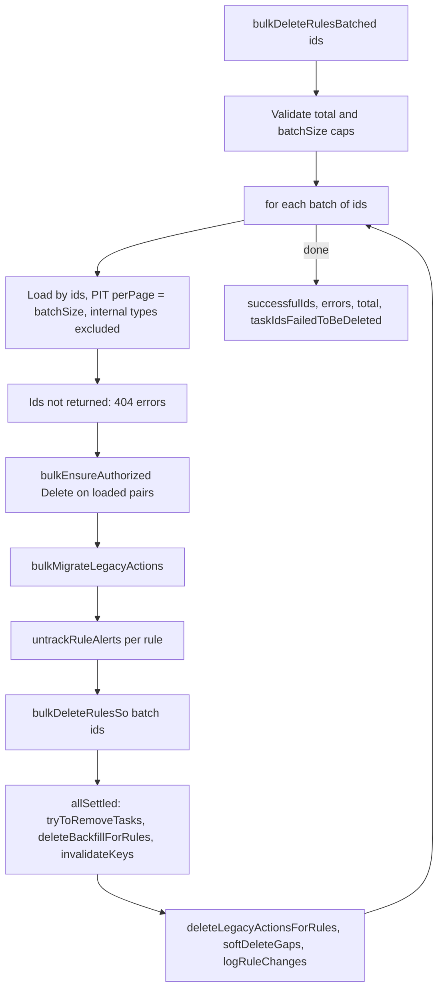

# Lean bulk delete: `bulkDeleteRulesBatched`

## Approach

A new, additive RulesClient method. The existing `bulkDeleteRules` (filter or ids, full `rules[]` result, used by the Alerting HTTP route and Stack/Observability) is not touched. That removes the overload / `jest.Mocked` problem and the `bulkDeleteWithOCC` rewrite.

Shape follows [bulk_update_rules.ts](x-pack/platform/plugins/shared/alerting/server/application/rule/methods/bulk_update/bulk_update_rules.ts):

```ts
export interface BulkDeleteRulesBatchedParams {
  ids: string[];
  /** Per-batch size; also the PIT read size. */
  batchSize?: number;
  changeTracking?: Omit<RuleChangeTracking, 'action'>;
}

export interface BulkDeleteRulesBatchedResult {
  successfulIds: string[];
  errors: BulkOperationError[];
  total: number;
  taskIdsFailedToBeDeleted: string[];
}
```

The result is bounded by the incoming `ids` array. `total > MAX_RULES_NUMBER_FOR_BULK_OPERATION` (10,000) throws `badRequest`, and the batch size is checked against new caps.



## Alerting changes

- [constants.ts](x-pack/platform/plugins/shared/alerting/server/rules_client/common/constants.ts): `MIN_BULK_DELETE_BATCH_SIZE = 10`, `DEFAULT_BULK_DELETE_BATCH_SIZE = 200`, `MAX_BULK_DELETE_BATCH_SIZE = 500`, matching the create/update caps.
- New `application/rule/methods/bulk_delete_batched/` with `types.ts`, `index.ts`, `bulk_delete_rules_batched.ts`:
  - Validation and loop copied from `bulkUpdateRules`: empty ids returns empty, then the hard limit and batch caps, then `remaining.splice(0, batchSize)`. Log `${total} input(s), Nx batches of ${batchSize}` at debug.
  - `runBatch`:
    1. Load the batch with a PIT, `filter: convertRuleIdsToKueryNode(ids)` AND-ed with the internal rule type filter, `perPage: batchSize`. Either reuse `loadRulesByIds` from [bulk_update/utils.ts](x-pack/platform/plugins/shared/alerting/server/application/rule/methods/bulk_update/utils.ts) with a new optional `perPage` argument (moving it to `common_utils`), or add a small local loader.
    2. Ids not loaded become `{ status: 404, message: 'Rule not found' }` errors.
    3. `context.authorization.bulkEnsureAuthorized` with `WriteOperations.Delete` on the loaded `(alertTypeId, consumer)` pairs, same as `bulkUpdateRules.runBatch`.
    4. `bulkMigrateLegacyActions` on the loaded rules.
    5. Audit each rule (`RuleAuditAction.DELETE`, outcome `unknown`), then `untrackRuleAlerts` per rule.
    6. `bulkDeleteRulesSo` with the loaded ids. Fold statuses into successful ids and errors, keeping the name from the loaded SO.
    7. Per-batch flush, only for successfully deleted ids: `Promise.allSettled([tryToRemoveTasks(taskIds), context.backfillClient.deleteBackfillForRules(...), invalidateKeys(entries, context)])`. `invalidateKeys` from [invalidate_keys.ts](x-pack/platform/plugins/shared/alerting/server/application/rule/methods/common_utils/invalidate_keys.ts) already handles `apiKeyCreatedByUser` and UIAM keys, and never throws. Collect `taskIdsFailedToBeDeleted`.
    8. `deleteLegacyActionsForRules` for deleted migrated ids, `softDeleteGapsByQuery` (try/catch, log), and `logRuleChanges` with `ruleDelete` and `metadata: { bulkCount: total, ...changeTracking?.metadata }`.
  - Wrap each step in `withSpan` named `bulkDeleteRulesBatched.runBatch.*`, like update.
  - No `toRuleDomain` and no rebuilt `rules[]`.
- [rules_client.ts](x-pack/platform/plugins/shared/alerting/server/rules_client/rules_client.ts): `public bulkDeleteRulesBatched = (params) => withSpan({ name: 'RulesClient.bulkDeleteRulesBatched' }, ...)`. Add the method to [rules_client.mock.ts](x-pack/platform/plugins/shared/alerting/server/rules_client.mock.ts).

## Security changes

- [bulk_delete_rules.ts](x-pack/solutions/security/plugins/security_solution/server/lib/detection_engine/rule_management/logic/detection_rules_client/methods/bulk_delete_rules.ts): drop the `CHUNK_SIZE = 1000` loop and the `RulesNotFoundError` catch. One call to `rulesClient.bulkDeleteRulesBatched({ ids, changeTracking })`. Map `successfulIds` to `rulesById`. 404 errors and any id missing from both lists become `skipped: RULE_NOT_FOUND`. The result shape returned to the route stays the same.
- [install_promotion_rules.ts](x-pack/solutions/security/plugins/security_solution/server/lib/detection_engine/prebuilt_rules/logic/integrations/install_promotion_rules.ts): switch to `bulkDeleteRulesBatched`. It only reads `errors`.

## Tests

- New `bulk_delete_rules_batched.test.ts`, modelled on `bulk_update_rules.test.ts`:
  - caps: empty, over 10,000, batch size below/above limits
  - 450 ids at batch size 200 gives 3 loads (`perPage` = 200) and 3 SO deletes
  - missing ids give 404 errors
  - SO per-item error stays in `errors`, and that id is not flushed
  - each batch flushes only its own tasks, backfills and keys
  - a rejected TM remove ends up in `taskIdsFailedToBeDeleted` and later batches still run
  - authz failure behaviour (see attention item 2)
  - no domain transform is called
- Security [bulk_delete_rules.test.ts](x-pack/solutions/security/plugins/security_solution/server/lib/detection_engine/rule_management/logic/detection_rules_client/methods/bulk_delete_rules.test.ts) and the bulk action route tests: mock `bulkDeleteRulesBatched` and drop the 1000-chunk test.
- Run `node scripts/jest <file>`, then `node scripts/type_check --project` for the alerting and security_solution tsconfigs.

## Bench

- Same local flow as before (import 1000 enabled rules, then `ACTION=delete ./parallel_bulk_action.sh`) against localhost:5606/kbn.
- Compare against trace `178cb7c812087b8877c00c1484b68be4` (4.53s): total wall, `toRuleDomain` gone, number of `_bulk` calls, per-batch spans. Share the monitoring APM link.
- Fill in the `#TBD` row with impact and complexity.

## Needs your attention

1. **"Returns a list of deleted rules" is read as ids.** The plan returns `successfulIds`, matching `bulkCreateRules` / `bulkUpdateRules`, and Security maps them back to its pre-fetched rules. If you meant rule objects, that brings back the per-rule transform.
2. **Authz failure mid-run.** `bulkUpdateRules` throws when `bulkEnsureAuthorized` fails for a batch, after earlier batches are already committed. For delete, I'd rather turn that batch into per-rule 403 errors and carry on, so the call never throws half-way. That differs from update. Throw (parity) or 403 per rule?
3. **No up-front auth over all ids.** The old method runs `checkAuthorizationAndGetTotal` on the whole filter. Doing that for up to 10,000 ids blows the KQL clause limit, which is why Security chunks at 1000. Per-batch authz avoids it, but there's no "you can't delete these" fail-fast before anything gets deleted.
4. **No 409 retry loop.** An SO delete has no version, so conflicts aren't realistic. The plan drops `retryIfBulkOperationConflicts` and reports any 409 as an error. Say if you want update-style `writeWithRetry` kept for parity.
5. **Internal rule types** are excluded in the load filter, so they come back as 404 errors. The old path filtered them out silently via `ignoreInternalRuleTypes`. Security never targets them, so this only matters for other future callers.
6. **`untrackRuleAlerts` stays serial per rule.** Out of scope here (#264895), but it's still the biggest cost on ECH runs with alerts.
7. **Not included:** `exitEarlyOnError` from create/update. Security doesn't need it. Easy to add if you want full parity.
