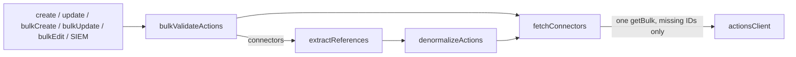

# Plan: `bulkValidateActions` (#273680)

Issue: https://github.com/elastic/kibana/issues/273680
Handoff: `.knowledge/handoff/handoff-2026-11-13-1654-bulk-validate-actions-impl.md`

## Goal

- One connector `getBulk` per **batch** (bulk create / bulk update) or per **page** (bulk edit, page size 100), shared by validate, system-action authorize and extract/denormalize.
- Single create/update go through the same function with one rule (1 fetch instead of 3).
- Delete `validateActions` and `validateAndAuthorizeSystemActions`. Their checks move into `bulkValidateActions`.

Decisions locked in:

- No `skipSystemActions` flag. The only flow that skipped system checks was SIEM legacy, and it never passes system actions (`RawRule` has no `systemActions`, and `transformRawActionsToDomainActions` filters them out), so the system checks return early on an empty list anyway.
- Bulk edit legacy-frequency retry does a **full** re-validate, so a system-action error can't be swallowed by the retry.
- Bulk edit prefetches **page-wide**: one fetch per OCC page.



## 1. Core helpers (`x-pack/platform/plugins/shared/alerting/server/rules_client/lib/`)

### `fetch_connectors.ts` (new)

```ts
export type Connectors = Map<string, ActionResult | InMemoryConnector>;
// Plus somewhere to keep per-ID errors from the retry pass. Shape is open (see "Open questions").

// Fetches only IDs not already in `known`; returns a merged map. Never throws.
export const fetchConnectors = async (
  actionsClient: ActionsClient,
  ids: string[],
  known?: Connectors
): Promise<Connectors>
```

- Always calls `getBulk({ ids, throwIfSystemAction: false })`, the same as all three current call sites.
- Missing IDs get **fetched, not dropped**. That avoids the `sliceActionsById` trap from prior art `d0483a2`.
- **Retry for all IDs, not per rule:** `getBulk` throws `Failed to load action ...` if *any* ID fails (`actions_client.ts:397`). If the union call throws that 400, retry each unique ID once in a single pass (`pMap`), and keep each ID's connector or error. Cost is O(unique connectors), about 10, not O(rules). With only one ID, store the union error directly and skip the retry.
- Any other error (403 from connector authz, ES failure) isn't retried. Store it against every ID in the call.
- Consumers look up the stored error for an ID and throw it, so messages stay the same as today. Each rule walks its own IDs in order (actions, then system actions) and throws the first stored error, which matches what its own `getBulk` would have thrown.

### `bulk_validate_actions.ts` (new)

```ts
export interface BulkValidateActionsItem {
  ruleType: UntypedNormalizedRuleType;
  data: ValidateActionsData;            // type moved from validate_actions.ts
  rule: { consumer: string; producer: string };
  allowMissingConnectorSecrets?: boolean;
}

export const bulkValidateActions = async (
  context: RulesClientContext,
  items: BulkValidateActionsItem[],
  { connectors }: { connectors?: Connectors } = {}
): Promise<{ errors: Array<Error | undefined>; connectors: Connectors }>
```

- Builds one union of IDs across all items: `actions` plus `systemActions`. Then makes **one** `fetchConnectors` call.
- **Fallback:** handled inside `fetchConnectors` (retry for all IDs, see above). Per item, the first stored error among its IDs becomes that item's error and skips its in-memory checks. Other rules still pass.
- One `listTypes({ includeSystemActionTypes: true })` per call. Filter `!isSystemActionType` for the endpoint-security and workflows-only checks, to match today's `listTypes({})` (`list_types.ts:30`).
- Per item, in memory:
  1. Actions checks, moved verbatim from `validate_actions.ts`. Keep the early return when `actions` is empty.
  2. System-action checks, moved verbatim from `validate_authorize_system_actions.ts`: is-system-action, allow-multiple, `bulkValidateConnectorAdapterActionParams`, and `actionsAuthorization.ensureAuthorized` (privileges depend on consumer/producer; how to run it across items is open, see "Open questions").
- `errors` is index-aligned with `items`. Single-rule callers throw `errors[0]`.
- Order is actions checks first, then system. That matches create/update/bulk create/bulk update. Bulk edit today runs system first, so the only difference is which message wins when both fail. Acceptable.

### `extract_references.ts` / `denormalize_actions.ts`

- Add an optional trailing `connectors?: Connectors`. `denormalizeActions` swaps its own `getBulk` for `fetchConnectors(actionsClient, ids, connectors)`, and throws the first stored error among its IDs (in order).
- Keep the `isActionTypeEnabled(..., { notifyUsage: true })` calls as they are.
- Backfill (`backfill_client.ts:696`) passes nothing, so behaviour is unchanged.

## 2. Bulk create and bulk update: one fetch per batch

### Bulk create: `bulk_create_rules.ts` `runBatch` + `bulk_create/utils.ts`

Split Phase B1 (today a single `prepareRule` pMap) into three:

1. **B1a, pMap:** `addGeneratedActionValues`, rule type lookup, params validate/authorize. Return the enriched `data` or a per-rule error.
2. **B1b, once per batch:** `bulkValidateActions(context, survivors)`. Push per-rule errors in the existing `BulkOperationError` shape.
3. **B1c, pMap:** API key, then `extractReferences(..., connectors)`, then build the prepared rule. Orphaned API key cleanup stays in this step's catch.

`strict`: check errors after B1b and return early, before B1c. No API keys get minted for a batch that's going to fail. Today they're minted, then invalidated.

### Bulk update: `bulk_update_rules.ts` `putAttempt` + `bulk_update/utils.ts`

Same three-phase split around `prepareUpdate`. The schedule-interval check moves to the start of the third phase, so it still runs after validate, as today.

## 3. Single create and update

- `create_rule.ts:192-204`: replace the two `withSpan` calls with one `withSpan({ name: 'bulkValidateActions' })` and throw `errors[0]`. Pass `connectors` to `extractReferences` (`:226`). The API key-before-validate order doesn't change.
- `update_rule.ts:196-203`: same swap. Thread `connectors` through `updateRuleAttributes` (`:281`) into its `extractReferences` call (`:315`).

## 4. Bulk edit: one fetch per page

### OCC loop: `rules_client/common/bulk_edit/bulk_edit_rules_occ.ts`

- Add `prefetch?: (rules: SavedObjectsFindResult<RawRule>[]) => Promise<Connectors | undefined>` to `BulkEditOccOptions`, replacing the design comment at `:44-45`.
- In the page loop, call it once per page **after** `bulkMigrateLegacyActions` (`:89`), because migration rewrites rule actions. Pass the result into each `updateFn` call.
- Add `connectors?: Connectors` to `UpdateOperationOpts` (`common/bulk_edit/types.ts:58`).
- `bulkEditRuleParams` doesn't pass `prefetch` for now. Whether to wire it is open (see "Open questions").

### Page prefetch: `bulk_edit_rules.ts`

- The union is the IDs from every `actions` op value plus each page rule's existing action IDs (`injectReferencesIntoActions(rule.id, rule.attributes.actions, rule.references)`).
- That covers `add`/`delete` post-merge, `set`, and non-actions ops (tags, schedule, snooze, apiKey), which still run extract.
- Skip the fetch if the union is empty. `fetchConnectors` never throws, so one dangling connector only fails the rules that use it. The rest of the page keeps the shared map.
- Wrap `injectReferencesIntoActions` per rule in a try/catch. A broken `actionRef` just leaves that rule's IDs out, and the rule fails later in `updateFn` the same way it does today.

### Per rule

- `getUpdatedAttributesFromOperations` (`:285-307`): replace both calls with `bulkValidateActions(context, [item], { connectors })` inside the existing `try`. Throw `errors[0]`.
- `attemptToMigrateLegacyFrequency` (`:461`): full `bulkValidateActions` re-run with `genSystemActions`, same `connectors`. A real system-action error fails again and throws.
- `update_rule_in_memory.ts:171`: pass `connectors` into `extractReferences`.

Result: 1000-rule edit goes from about 3000 `getBulk` calls to about 10 (one per page).

## 5. SIEM legacy

- `transform_and_delete_legacy_actions.ts:339` `validateTransformedActions`: use `bulkValidateActions(context, [item])` and throw `errors[0]`. No system actions reach this path, so the system checks are a no-op. `rule` comes from `rule.attributes.consumer` and `ruleType.producer`.
- Keep it per legacy SO for now. Batching across `bulkMigrateLegacyActions` is out of scope.

## 6. Delete old helpers

- Delete `rules_client/lib/validate_actions.ts` (move `ValidateActionsData` into `bulk_validate_actions.ts`) and `lib/validate_authorize_system_actions.ts`.
- Update `rules_client/lib/index.ts:13`: drop `validateActions`, export `bulkValidateActions`.
- Nothing outside alerting imports either helper, and no `jest.mock` targets them.

## 7. Tests

- `bulk_validate_actions.test.ts`: port every case from `validate_actions.test.ts` and `validate_authorize_system_actions.test.ts` as single-rule parity tests, then delete the old test files.
- New cases:
  - Two rules sharing connectors make one `getBulk` call.
  - A missing connector in rule A fails only A, with today's message. The retry makes one `getBulk` per unique ID, not per rule.
  - Two rules sharing a missing connector: both fail, and that ID is retried once.
  - Single ID: union error is stored directly, with no retry call.
  - No system actions: `ensureAuthorized` isn't called (covers the SIEM path).
  - When `connectors` is passed in, only missing IDs get fetched.
- `fetch_connectors.test.ts` (union success, union failure leading to the retry pass, `known` skips IDs), plus `denormalizeActions` cases that pass `connectors`, including one with a stored error.
- Existing tests that use `getBulk.mockRejectedValueOnce` (`create_rule.test.ts:2878`, `bulk_create_rules.test.ts:642`) need updating, because the retry pass makes a second call.
- Caller tests (create, update, bulk create, bulk update, bulk edit): assert `getBulk` call counts. Bulk edit gets one fetch per page across `set`/`add`/`delete`/tags.

## 8. Verify

- `node scripts/type_check --project x-pack/platform/plugins/shared/alerting/tsconfig.json`
- `node scripts/jest` on the touched alerting dirs (`rules_client/lib`, `application/rule/methods/{create,update,bulk_create,bulk_update,bulk_edit}`, `rules_client/common/bulk_edit`)
- `node scripts/eslint --fix $(git diff --name-only)`
- Wall bench scenarios #9 and #12 (`guides/detection_rule_wall_bench.md`) before claiming the win.

## Open questions (decide when implementing)

1. **Running `ensureAuthorized` across items.** Each call is an ES `_has_privileges` request. Today it runs inside `pMap` (50 at a time). A plain `for` loop with `await` would run them one after another, which is a regression. Options:
   - Run them through `pMap`, matching today's concurrency.
   - Dedupe by privilege set. Rules with the same consumer, producer and system actions get identical `additionalPrivileges`, so it's often one call per batch.
2. **Where per-ID errors from the retry pass live.** Options:
   - Inside `Connectors`: `Map<string, ActionResult | InMemoryConnector | Error>`. One object, but every reader has to narrow out `Error`.
   - A separate `Map<string, Error>` returned alongside `Connectors`. Keeps `Connectors` clean, but it's two things to pass around.
   - Either way, `fetchConnectors` shouldn't refetch an ID that `known` already has as failed.
3. **Wire the page prefetch into `bulkEditRuleParams`?** It shares the OCC loop and `updateRuleInMemory`, so it runs `extractReferences` on each rule's existing actions: one `getBulk` per rule. Security uses it when adding exceptions to rules. Passing the same prefetch (existing action IDs only) gets it to one fetch per page. Small change, but extra scope.

## Notes

- Local working copy is clean on `main`. The `// HERE:` call-site comments (14, across 9 files) are in `stash@{0}`. Run `git stash apply stash@{0}` if you want them while implementing, and remove them before committing.
- Freshness: the connector snapshot lives for one batch or page only, never across requests.
